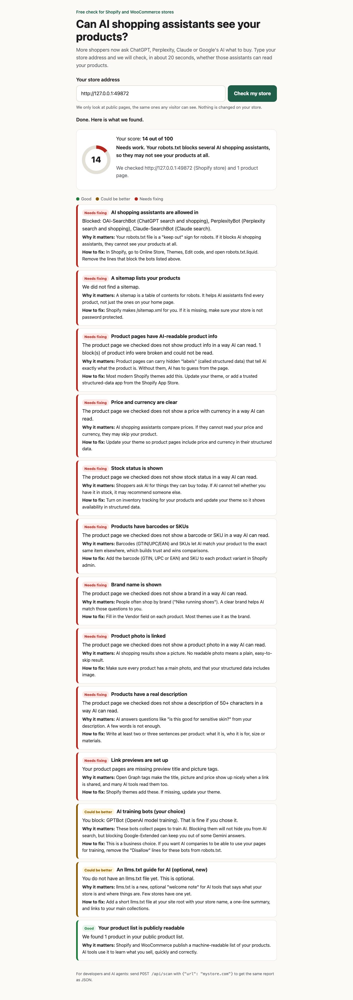

# AI Shopping Check

A free scan that shows whether AI shopping assistants (ChatGPT, Perplexity, Claude, Google AI Mode) can read a Shopify or WooCommerce store.

More shoppers now ask an AI assistant what to buy. If the assistant cannot read a store's products, it will not recommend them. Type a store address and in about 20 seconds you get:

- a score from 0 to 100,
- a checklist marked Good, Could be better, or Needs fixing,
- for every item, a plain "Why it matters" and a step-by-step "How to fix".

It only reads public pages, the same ones any visitor can see, and identifies itself as `AIShoppingCheck/0.1` in the user agent. It never changes anything on the store.



## Run it

You need [Node.js 22](https://nodejs.org) or newer. There is nothing else to install (no packages).

```
git clone https://github.com/joydai2026-del/ai-shopping-check.git
cd ai-shopping-check
npm start
```

Then open http://127.0.0.1:3000 in your browser and type a store address.

Prefer the command line? This prints the same report as JSON (replace `yourstore.com` with the store you want to check):

```
npm run --silent scan -- yourstore.com
```

## Using it with an AI agent

Paste this into Claude Code, Codex, or any coding agent that can run commands:

> Clone https://github.com/joydai2026-del/ai-shopping-check, then run `npm run --silent scan -- yourstore.com` inside it (replace yourstore.com with my store) (Node 22 needed, no installs). Explain the results in plain English. List the "Needs fixing" items first, with the exact fix for each.

If the server is already running (`npm start`), an agent or script can call the API directly:

```
curl -s -X POST http://127.0.0.1:3000/api/scan -H 'content-type: application/json' -d '{"url":"yourstore.com"}'
```

The server also serves `/llms.txt` (a short description of the API, written for AI agents) and `GET /api/health`.

## What it looks at

| Source | Shopify | WooCommerce |
|---|---|---|
| Home page (to detect the platform) | `/` | `/` |
| Robot rules | `/robots.txt` | `/robots.txt` |
| Public product list | `/products.json` and `/products/<handle>.json` | `/wp-json/wc/store/v1/products` (Store API) |
| Sitemap | `/sitemap.xml` (and one product sub-sitemap) | `wp-sitemap.xml` or the one named in robots.txt |
| AI welcome note | `/llms.txt` | `/llms.txt` |
| Up to 3 product pages | schema.org Product JSON-LD and Open Graph tags | same |

## The 13 checks and their weights

| Check | Weight | Pass / warn / fail rule |
|---|---|---|
| AI shopping assistants allowed (OAI-SearchBot, PerplexityBot, Claude-SearchBot, Claude-User, Googlebot), on the home page and every sampled product page, including where they redirect to | 18 | fail if 3+ are blocked, warn if 1-2. A ChatGPT-User block is shown as a note only, because OpenAI says robots.txt may not apply to visits a shopper starts |
| AI training bots (GPTBot, ClaudeBot, Google-Extended) | 5 | only ever a warning: blocking is a fair business choice |
| Public product list readable | 10 | fail if not found |
| Sitemap lists products | 10 | warn if no product pages in it |
| Product structured data present | 13 | per page: all = pass, some = warn, none = fail |
| Price and currency | 10 | same per-page rule |
| Stock status | 8 | same |
| Barcode (GTIN) or SKU | 8 | same, plus a GS1 check-digit test on barcodes |
| Brand | 4 | same |
| Product photo | 4 | same |
| Description of 50+ characters | 4 | same |
| Open Graph title and image | 4 | same |
| llms.txt present | 2 | warn if missing (optional, new) |

Score = sum of weights, where pass counts fully and warn counts half. 80+ is "Great", 50-79 "Getting there", under 50 "Needs work". If robots.txt blocks 3 or more shopping assistants, the result says "Needs work" whatever the score, because good product data does not help when the assistants are kept out.

## Settings (all optional)

Set these as environment variables, or put them in `./.env` or `~/.config/ai-shopping-check/env`. The real environment wins, then the config file, then `.env`. Copy `.env.example` to start.

| Name | Default | Meaning |
|---|---|---|
| `PORT`, `HOST` | 3000, 127.0.0.1 | Where the server listens |
| `TRUST_PROXY_HOPS` | 0 | Set to 1 behind one hosting proxy so rate limits count each visitor, not the proxy |
| `SCAN_MAX_PRODUCT_PAGES` | 3 | Product pages read per scan (1-10) |
| `SCAN_MAX_REQUESTS` | 20 | Total web requests per scan |
| `SCAN_TIMEOUT_MS` / `SCAN_TOTAL_TIMEOUT_MS` | 8000 / 30000 | Per request / whole scan |
| `SCAN_MAX_BYTES` | 2000000 | Biggest page it reads |
| `SCANS_PER_MINUTE_PER_IP` | 6 | Scans per visitor per minute |
| `MAX_CONCURRENT_SCANS` | 3 | Scans at the same time |

## Safety

- **No snooping on private networks (SSRF guard).** `src/safe-fetch.js` only allows http and https on ports 80 and 443, rejects names like `localhost` and `*.local`, and checks every DNS answer at connect time. A name that points to `127.0.0.1`, `10.x`, `169.254.169.254` (cloud metadata) or IPv6 local ranges is refused. Redirects are re-checked at each hop (max 4).
- **Limits.** A timeout per request, a size cap (also after gzip), a 20-request budget per scan, a total time limit per scan (on the website and the command line), rate limits, and a cap on scans running at once.
- **Hostile pages.** Every parser (robots.txt, HTML, JSON-LD, sitemaps) runs in near-linear time with length caps, so a crafted page cannot freeze the server. A broken or cut-off answer is caught and its connection is closed.
- **Page safety.** Store text is shown with `textContent` only, and the page sends a strict Content Security Policy.
- **No accounts, no tracking, no payments.** The tool does not store who scanned what.

## Test it

```
npm test               # unit, server and end-to-end tests, offline (one live test is skipped)
npm run test:browser   # headless Chrome at desktop and phone sizes (set CHROME_PATH if Chrome is not found)
npm run test:live      # optional: scans one real public Shopify store
```

Tests use hand-written sample stores in `tests/fixtures/`, not copies of real stores. CI runs the tests plus a secret scan (gitleaks) on every push and pull request, and every Monday.

## More

- [docs/research.md](docs/research.md): what AI shopping tools read today, with sources.
- [docs/build-notes.md](docs/build-notes.md): how the first version was tested and reviewed.
- [docs/hosting.md](docs/hosting.md): how to host your own copy.

## License

MIT. See [LICENSE](LICENSE). Copyright 2026 Joy Dong.
